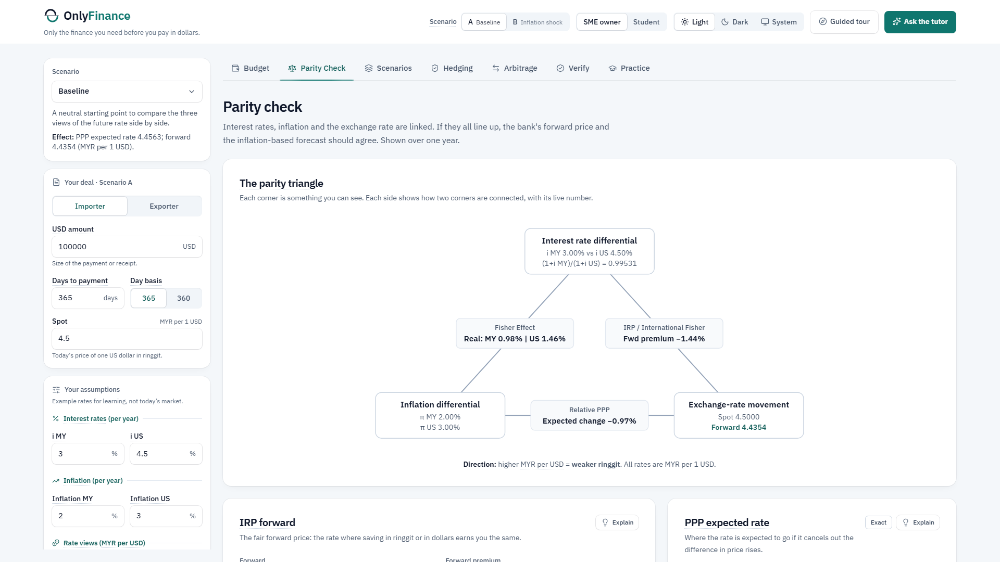

# OnlyFinance

**Only the finance you need before you pay in dollars.**

OnlyFinance is an interactive learning app for **non-finance Malaysian SME importers and exporters**. Enter a USD invoice and a few assumptions (interest rates, inflation, today's exchange rate), and it shows what the deal will cost in ringgit, *why*, and what hedging would change. It connects the three variables of CLO3 (interest rates, inflation and exchange-rate movement) through Interest Rate Parity, Purchasing Power Parity and the Fisher effect.

`build: passing` · `tests: 137/137` · `localhost only`

> All rates in the app are **illustrative, not market data**. OnlyFinance is an educational tool, not financial advice.



## About

OnlyFinance is a group project (Group 3) for **GFB3043 / GEB3043 International Financial Management**, Department of Management, Universiti Teknologi PETRONAS (UTP), September 2026 semester. It is our entry for the **FinBridge AI Innovation Challenge**, which targets **CLO3: analyse the relationship among interest rate, inflation rate and foreign exchange movement**.

**Problem:** most Malaysian SMEs have no treasury team, pay suppliers in USD and plan in ringgit. **Target users:** non-finance Malaysian SME importers and exporters, plus non-finance students learning the same ideas.

---

## Why it exists

Most Malaysian SMEs are micro or small firms with no treasury team. They pay suppliers in USD but plan in ringgit, so when the ringgit moves between order and payment, budgets overrun. Bank FX desks and fintech apps help **execute** trades. They rarely explain **why** the rate moves or what interest and inflation mean for the ringgit budget. OnlyFinance fills that gap with transparent formulas, worked steps and plain-language explanations.

## What it does

| Area | Features |
|---|---|
| **Budget** | Ringgit cost of the invoice at spot, the IRP forward, the PPP forecast, the International Fisher expectation, a stress rate and your own forecast. Bank spread effect. Importer and exporter modes |
| **Parity Check** ⭐ | The parity triangle with live numbers: IRP forward and premium, relative PPP (exact and approximate), Fisher real rates, IFE. The key identity **Forward ÷ PPP forecast = (1 + r_MY) ÷ (1 + r_US)** shows that the gap between "the price of certainty" and "where inflation says the rate is heading" is the real-interest-rate gap |
| **Scenarios** | Scenario A vs B side by side, a sensitivity slider and a tornado chart showing which input moves the ringgit cost most |
| **Hedging** | Forward, currency option (call for importers, put for exporters) and money-market hedge on one payoff chart, with break-even rates |
| **Arbitrage** | Covered interest arbitrage check against a bank-quoted forward, before and after spreads |
| **Verify** | Every engine result checked against the lecturer's Week 5–6 Excel workbook and the Week 10 study guide |
| **Practice** | Predict the result first, the engine marks it, and the AI gives personalised feedback on the mistake |
| **AI tutor** | Ask questions in plain language. The AI calls the finance engine as tools, explains the result, and a **number guard** marks every number it writes as ✓ verified, or corrects it |
| **Learning aids** | "Show workings" on every result (formula → substitution → result), Explain buttons, a 6-step guided tour, a limitations panel, Student / SME-owner tone |

### How the AI is kept honest

The brief requires that AI-generated answers be checked against independently verified calculations. OnlyFinance uses **two-track compute**:

1. A rule-based TypeScript **engine** computes every number. It is tested against the lecturer's workbook.
2. The **AI** (via OpenRouter) calls engine functions as tools and may show its own working.
3. The **number guard** compares every number in the AI's reply with the engine's results. Matches get ✓; wrong numbers are struck through and replaced by the verified value.

If no API key is set, or the network is down, the app still works and the AI panels show offline template explanations.

## Finance models

Quoting convention: **MYR per 1 USD** (a higher number means a weaker ringgit). Rates are annual; tenors under a year scale by days ÷ 365 (or 360).

| Model | Formula |
|---|---|
| Interest Rate Parity (forward) | F = S × (1 + i_MY·t) / (1 + i_US·t) |
| Relative PPP (expected spot) | E(S) = S × (1 + π_MY) / (1 + π_US) |
| Fisher effect (real rate) | r = (1 + i) / (1 + π) − 1, approx r ≈ i − π |
| International Fisher Effect | E(S) = S × (1 + i_MY) / (1 + i_US): same maths as IRP, read as an expectation |
| Parity Check identity | F / E_PPP(S) = (1 + r_MY) / (1 + r_US) |
| Covered interest arbitrage | Compare the quoted forward with the IRP forward; profit after spreads |
| Hedges | Forward; option: call = max(S − K, 0) − premium; money market: borrow, convert, deposit |

**Worked example (illustrative):** spot 4.50, i_MY 3%, i_US 4.5%, π_MY 2%, π_US 3%, invoice USD 100,000, one year.

| View | Rate (MYR/USD) | Ringgit cost |
|---|---|---|
| Spot today | 4.5000 | RM450,000 |
| IRP forward | 4.4354 | RM443,541 |
| PPP forecast | 4.4563 | RM445,631 |
| Stress | 4.7000 | RM470,000 |

Raise Malaysian inflation to 4% and the PPP forecast moves to 4.5437 (RM454,369) while the forward does not move. The RM10,828 gap is the case for hedging.

## Tech stack

React 19 · Vite 8 · TypeScript 7 · Tailwind CSS 4 · Recharts 3 · Vitest 5 · OpenRouter (OpenAI-compatible chat completions with tool calling).

## Getting started

Full step-by-step local setup (Windows first, then macOS/Linux) is in [SETUP.md](SETUP.md).

Requirements: Node.js 24+ and npm 11+.

```bash
npm --prefix app install
cp .env.example .env.local      # optional, enables the AI tutor
npm --prefix app run dev        # open the printed localhost URL
```

`.env.local` (repo root, git-ignored):

```bash
OPENROUTER_API_KEY=             # from https://openrouter.ai/settings/keys (never committed, never sent to the browser)
VITE_OPENROUTER_MODEL=nvidia/nemotron-3-ultra-550b-a55b:free
VITE_OPENROUTER_FALLBACK_MODEL=nvidia/nemotron-3.5-lightning:free
```

The API key is read only by the Vite dev-server proxy (`/api/llm`), so it never reaches the browser bundle. The app runs fully without a key.

| Command | What it does |
|---|---|
| `npm --prefix app run dev` | Start the app on localhost |
| `npm --prefix app run build` | Type-check and build |
| `npm --prefix app test` | Verify the engine against the course workbook (137 checks) |

Tip: open a tab directly with a URL hash such as `#parity`, `#hedging` or `#verify`.

## Verification

`app/src/verify.test.ts` checks the engine against every sheet of the course's Week 5–6 calculation workbook (IRP, covered interest arbitrage, PPP, Fisher, import budget, forward hedge, USD call, option payoffs) and the Week 10 study guide, plus the parity identity on four data sets, day-count, spreads, break-evens, tool-registry coverage and the number guard. **Current result: 137 / 137 passing.**

## Project structure

```
OnlyFinance/
├── app/                    The web app
│   ├── src/engine/         Finance engine: pure TypeScript, every function returns its workings
│   ├── src/ai/             OpenRouter client, tool registry, number guard, tutor, practice mode
│   ├── src/ui/             Screens, sidebar, guided tour
│   ├── src/verify.test.ts  Verification against the course materials
│   └── screenshots/        App screenshots
├── context/notes/          Working research notes and brainstorm
├── design-system/          Design tokens and guidance
├── refdocs/                PRD, status, decisions, changelog, build plans
└── CLAUDE.md               Operating brief for AI-assisted development sessions
```

## Limitations

- PPP holds mainly in the long run; short-run exchange rates deviate.
- IRP ignores transaction costs, taxes and capital controls; the IRP forward is not a bank quote.
- Forecasts are scenarios, not predictions. All rates are illustrative.
- The International Fisher Effect assumes equal real interest rates across countries.
- Educational tool only; not financial advice.

## Team

Group 3 · GFB3043 / GEB3043 · Bachelor of Computer Science (CS), Universiti Teknologi PETRONAS

- Abdul Hafiz bin Mohd Noor Azman
- Muhammad Khaidhir bin Mohd Razin
- Fakhrul Azim bin Ahmed Mardzukie
- Nur Alia Syahira binti Azmi
- Nur Farah binti Ahmad Nazri

## AI-use disclosure

AI tools supported ideation, research summarisation, coding (Claude Code) and the in-app explanations (an OpenRouter-hosted model). Every formula and number is computed by the rule-based engine and verified against the course workbook; AI-written text is checked by the number guard. Only synthetic, illustrative data is used. The team is responsible for all claims.

## Documentation

| Doc | Contents |
|---|---|
| [`SETUP.md`](SETUP.md) | Local setup guide |
| [`refdocs/onlyfinance-PRD.md`](refdocs/onlyfinance-PRD.md) | Scope, architecture, roadmap, decision log |
| [`refdocs/STATUS.md`](refdocs/STATUS.md) | Build status |
| [`refdocs/changelog/DECISIONS.md`](refdocs/changelog/DECISIONS.md) | Design decisions |
| [`refdocs/guides/env_setup.md`](refdocs/guides/env_setup.md) | Environment variables |
| [`refdocs/onlyfinance-sources.md`](refdocs/onlyfinance-sources.md) | Sources and rejected options |

## Course materials and sources

The formulas follow the course's Week 5–6 and Week 10 teaching materials. The lecturer's workbook and slides are not redistributed in this repository. Public references used for the SME context and rates background:

- SME Corp Malaysia (SME definitions and statistics)
- OECD and DOSM (Department of Statistics Malaysia) data on SMEs and trade
- Bank Negara Malaysia (BNM) publications on FX and interest rates
- ACCA and Kantox material on SME currency risk
- UOB SME FX guidance

Details and rejected options are in [`refdocs/onlyfinance-sources.md`](refdocs/onlyfinance-sources.md).

## Third-party credits

- [lucide-react](https://lucide.dev) (ISC)
- [IBM Plex](https://github.com/IBM/plex) fonts (SIL OFL 1.1)
- Recharts, React, Vite, Tailwind CSS (MIT)
- Design guidance skills in `.claude/skills/`: Emil Kowalski skills (MIT), unslop by Damir Sokolovsky (CC-BY-4.0), ui-ux-pro-max (MIT)

## Academic integrity

Built for a course assignment. All data is illustrative. This is not financial advice.

---

© 2026 OnlyFinance team (Group 3). All rights reserved. Coursework project; not licensed for reuse.
